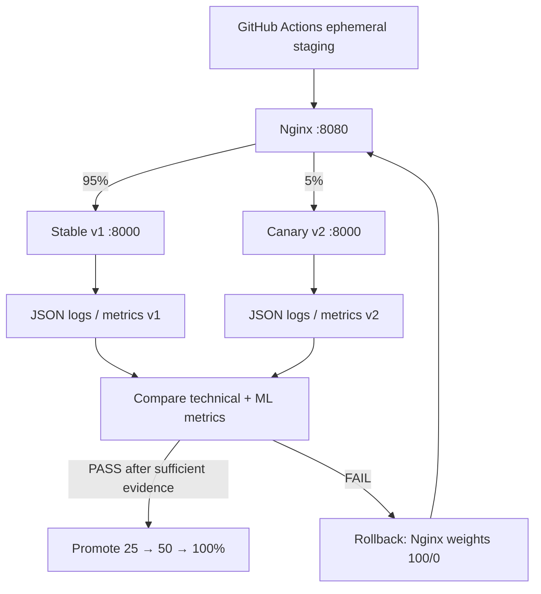

# Схема deployment

**Замечание:** GitHub-hosted runner не является постоянной средой. Схема пригодна для учебного испытания и локального запуска, но для production нужен стабильный внешний runtime, доступ к мониторингу и проверка SLA на реальном трафике.
